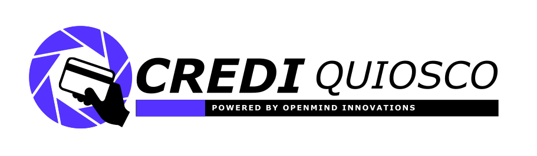

<a id="readme-top"></a>

<!-- PROJECT LOGO -->
<br />
<div align="center">
  <a href="https://github.com/FERNAN19898/credi-quiosco">



  <h1 align="center">Credi Quiosco</h1>
  <p align="center">
    <strong>Sistema de pago con tarjetas contact-less para quioscos y negocios en instituciones educativas.</strong>
</div>

<!-- TABLE OF CONTENTS -->
<details open>
  <summary>Tabla de Contenidos</summary>
  <ol>
    <li>
      <a href="#-acerca-del-proyecto">Acerca del Proyecto</a>
      <ul>
        <li><a href="#contexto-y-problemática">Contexto y Problemática</a></li>
        <li><a href="#la-solución-crediquiosco">La Solución: Credi Quiosco</a></li>
        <li><a href="#tecnologías-utilizadas">Tecnologías Utilizadas</a></li>
      </ul>
    </li>
    <li>
      <a href="#-arquitectura-del-sistema">Arquitectura del Sistema</a>
    </li>
    <li>
      <a href="#-conexión-del-hardware-pinout">Conexión del Hardware (Pinout)</a>
      <ul>
        <li><a href="#componentes-principales">Componentes Principales</a></li>
        <li><a href="#tabla-de-pines-esp32-devkit-v1">Tabla de Pines ESP32 DevKit V1</a></li>
      </ul>
    </li>
    <li>
      <a href="#-comenzando">Comenzando</a>
      <ul>
        <li><a href="#requisitos-previos">Requisitos Previos</a></li>
        <li><a href="#instalación-del-servidor-backend">Instalación del Servidor Backend</a></li>
        <li><a href="#configuración-y-flasheo-del-esp32">Configuración y Flasheo del ESP32</a></li>
      </ul>
    </li>
    <li>
      <a href="#-uso-y-flujos-del-sistema">Uso y Flujos del Sistema</a>
      <ul>
        <li><a href="#1-terminal-de-ventas-esp32_client">1. Terminal de Ventas (esp32_client)</a></li>
        <li><a href="#2-estación-administrativa-esp32_admin">2. Estación Administrativa (esp32_admin)</a></li>
        <li><a href="#3-simulador-web-interactivo-y-panel-administrativo">3. Simulador Web Interactivo y Panel Administrativo</a></li>
        <li><a href="#endpoints-de-la-api-rest">Endpoints de la API REST</a></li>
      </ul>
    </li>
    <li><a href="#-reglas-de-negocio-y-seguridad">Reglas de Negocio y Seguridad</a></li>
    <li><a href="#-hoja-de-ruta-roadmap">Hoja de Ruta (Roadmap)</a></li>
    <li><a href="#-contribuciones">Contribuciones</a></li>
    <li><a href="#-licencia">Licencia</a></li>
    <li><a href="#-contacto">Contacto</a></li>
    <li><a href="#-agradecimientos">Agradecimientos</a></li>
  </ol>
</details>

<p align="right">(<a href="#readme-top">Volver arriba</a>)</p>

---

<!-- ABOUT THE PROJECT -->

## 📌 Acerca del Proyecto

### Contexto y Problemática

En las primarias y secundarias de Perú existen quioscos o cafetines para la venta de alimentos y bebidas a los alumnos. Estos bajo un acuerdo con la Asamblea de Padres de Familia (APAFA) y la Dirección de la Institución Educativa (IE).

Los estudiantes tienen un recreo de entre 15 a 20 minutos (dependiendo a la institucion) en los que deben ir a los servicios. Comprar alimentos o terminar algun pendiente.

La problemática se centra en el contexto del quiosco / cafetin. Debido al poco tiempo que tienen, muchos alumnos optaban por comprar mediante billeteras electronicas como **Yape** y **Plin**. Sin embargo, la promulgación de la **Ley N.º 32385** prohíbe el uso de teléfonos celulares y dispositivos digitales inteligentes durante el horario escolar en instituciones educativas de educación básica regular (inicial, primaria y secundaria).

Ademas el uso de efectivo trae problemas como la perdida de dinero, robos, retrasos por falta de cambio y problemas de higiene en la manipulación de alimentos.

### La Solución: Credi Quiosco

**Credi Quiosco** fue creado como una solucion para estos dilemas. Es un sistema que permite el pago mediante tarjetas personalizadas por la institucion educativa o llaveros NFC físicos y un PIN confidencial de 4 dígitos en un teclado físico.

El saldo monetario **nunca reside en la tarjeta física** (evitando clonaciones o falsificaciones); reside en una base de datos protegida. Esto hace que el sistema sea mucho más seguro que los métodos tradicionales. Ademas las transacciones son rapidas y eficientes.

Por otro lado, permite que los padres carguen saldos de forma virtual. Dicha transaccion se hace directamente con el encargado del quiosco, misma persona que tiene acceso a una interfaz web donde puede registrar el abono. Y el sistema se encargara de sicronizarlo todo y dejarlo listo para el consumo del alumno.

<p align="right">(<a href="#readme-top">Volver arriba</a>)</p>

### Tecnologías Utilizadas

#### Backend & Web
* [![Node.js][NodeJS-badge]][NodeJS-url]
* [![TypeScript][TypeScript-badge]][TypeScript-url]
* [![Express.js][Express-badge]][Express-url]
* [![SQLite][SQLite-badge]][SQLite-url]

#### Hardware & Embebidos
* [![ESP32][ESP32-badge]][ESP32-url]
* [![Arduino][Arduino-badge]][Arduino-url]
* [![C++][Cpp-badge]][Cpp-url]

<p align="right">(<a href="#readme-top">Volver arriba</a>)</p>

---

<!-- SYSTEM ARCHITECTURE -->

## 🏗️ Arquitectura del Sistema

```
 ┌─────────────────────────────────────────────────────────────┐
 │                     ALUMNO / QUIOSQUERO                     │
 └──────────────────────────────┬──────────────────────────────┘
                                │
               [Tarjeta RFID / Llavero NFC 13.56MHz]
                                │
                                ▼
 ┌─────────────────────────────────────────────────────────────┐
 │                TERMINAL CLIENTE (ESP32)                     │
 │  - Lector RFID MFRC522 (Lectura de UID Hardware)            │
 │  - Teclado Matricial 4x4 I2C PCF8574 (PIN y Monto)          │
 │  - Pantalla LCD 20x4 I2C (Instrucciones y Saldos)           │
 │  - Buzzer + LEDs de Estado (Verde / Rojo)                   │
 │  - Conexión WiFiClientSecure (HTTPS Cloudflare / LAN)       │
 └──────────────────────────────┬──────────────────────────────┘
                                │
                                │ POST /api/transaccion
                                │ Body: { uid, pin, monto }
                                ▼
 ┌─────────────────────────────────────────────────────────────┐
 │                 BACKEND API REST (Node.js)                  │
 │  - Validación de existencia de tarjeta y alumno             │
 │  - Verificación estricta de PIN                             │
 │  - Validación de saldo suficiente                           │
 │  - Registro atómico de transacción                          │
 │  - SQLite Database con soporte WAL                          │
 └─────────────────────────────────────────────────────────────┘
```

<p align="right">(<a href="#readme-top">Volver arriba</a>)</p>

---

<!-- HARDWARE SETUP -->

## 🔌 Conexión del Hardware (Pinout)

### Componentes Principales
1. **ESP32 DevKit V1 (30 pines / 38 pines)**
2. **Lector RFID-RC522 (13.56 MHz)** con interfaz SPI
3. **Teclado Matricial 4x4** con expansor I2C **PCF8574**
4. **Pantalla LCD 20x4** con módulo I2C
5. **Buzzer Pasivo 5V** para distintos tonos
6. **Diodo LED Verde y Diodo LED Rojo** (con resistencias de 220Ω / 330Ω)
7. Tarjetas o etiquetas adhesivas NFC / RFID ISO 14443A (Mifare Classic / NTAG)

### Tabla de Pines ESP32 DevKit V1

| Módulo / Periférico      | Pin del Módulo    | Pin GPIO ESP32     | Tipo de Señal / Protocolo | Notas                                            |
| ------------------------ | ----------------- | ------------------ | ------------------------- | ------------------------------------------------ |
| **MFRC522 (RFID)**       | SDA / SS          | **GPIO 5**         | SPI Chip Select           | Nivel lógico 3.3V                                |
| **MFRC522 (RFID)**       | SCK               | **GPIO 18**        | SPI Clock                 | Bus SPI nativo (VSPI)                            |
| **MFRC522 (RFID)**       | MOSI              | **GPIO 23**        | SPI MOSI                  | Nivel lógico 3.3V                                |
| **MFRC522 (RFID)**       | MISO              | **GPIO 19**        | SPI MISO                  | Nivel lógico 3.3V                                |
| **MFRC522 (RFID)**       | RST               | **GPIO 4**         | GPIO Digital              | Reset de tarjeta                                 |
| **MFRC522 (RFID)**       | 3.3V & GND        | **3V3 & GND**      | Alimentación              | ⚠️ **No conectar a 5V**                          |
| **LCD 20x4 I2C**         | SDA               | **GPIO 21**        | I2C Data                  | Bus I2C compartido ( `0x27` ) |
| **LCD 20x4 I2C**         | SCL               | **GPIO 22**        | I2C Clock                 | Bus I2C compartido ( `0x27` ) |
| **LCD 20x4 I2C**         | VCC & GND         | **VIN (5V) & GND** | Alimentación              | 5V para óptimo contraste                         |
| **Keypad I2C (PCF8574)** | SDA               | **GPIO 21**        | I2C Data                  | Bus I2C compartido ( `0x20` ) |
| **Keypad I2C (PCF8574)** | SCL               | **GPIO 22**        | I2C Clock                 | Bus I2C compartido ( `0x20` ) |
| **Keypad I2C (PCF8574)** | VCC & GND         | **3V3/5V & GND**   | Alimentación              | Compatible 3.3V o 5V                             |
| **Buzzer Activo**        | Polo Positivo (+) | **GPIO 2**         | GPIO Digital / PWM        | Beeps de confirmación y error                    |
| **LED Verde**            | Ánodo (+)         | **GPIO 13**        | GPIO Digital              | Pago Aprobado                                    |
| **LED Rojo**             | Ánodo (+)         | **GPIO 14**        | GPIO Digital              | Pago Rechazado / Bloqueo                         |

<p align="right">(<a href="#readme-top">Volver arriba</a>)</p>

---

<!-- GETTING STARTED -->

## 🚀 Comenzando

Sigue estos sencillos pasos para levantar el servidor localmente y flashear el firmware en tus microcontroladores.

### Requisitos Previos

* **Node.js** (versión 20.x o superior recomendada, con soporte para `node:sqlite`)
  ```sh
  node -v
  npm -v
  ```
* **Arduino IDE 2.x** con el paquete de placas **esp32 by Espressif Systems** instalado.
* Librerías de Arduino requeridas (disponibles en el Library Manager):
  * `MFRC522` de GithubCommunity
  * `LiquidCrystal_I2C` de Frank de Brabander
  * `I2CKeyPad` de Rob Tillaart
  * `ArduinoJson` de Benoit Blanchon (versión 6.x o 7.x)

---

### Instalación del Servidor Backend

1. Clona el repositorio:
   ```sh
   git clone https://github.com/FERNAN19898/Credi Quiosco.git
   cd Credi Quiosco
   ```

2. Instala las dependencias del proyecto:
   ```sh
   npm install
   ```

3. Configura las variables de entorno creando un archivo `.env`:
   ```env
   PORT=3000
   NODE_ENV=development
   DB_FILE=./data/crediquiosco.db
   ```

4. Inicia el servidor en modo desarrollo:
   ```sh
   npm run dev
   ```
   O compila e inicia en producción:
   ```sh
   npm run build
   npm start
   ```

5. Abre tu navegador web en `http://localhost:3000/panel` o ` http://localhost:3000/simulador` para acceder al **Simulador Web y Panel de Control**.

---

### Configuración y Flasheo del ESP32

El proyecto incluye dos firmwares listos para usar en la carpeta [ `firmware/` ]:

1. **Terminal de Ventas:** Abre [ `firmware/esp32_client/esp32_client.ino` ]

2. **Estación de Administración:** Abre [ `firmware/esp32_admin/esp32_admin.ino` ]

En ambos archivos, ajusta tus credenciales Wi-Fi y la URL de tu servidor:
```cpp
const char* ssid = "TU_RED_WIFI";
const char* password = "TU_CONTRASEÑA";

const char* statusURL = "https://tudominio-o-ip-mas-puerto/api/status";
const char* transactionURL = "https://tudominio-o-ip-mas-puerto/api/transaccion";
```

> **Nota para HTTPS con Cloudflare:** El firmware utiliza `WiFiClientSecure ` con ` client.setInsecure()`, permitiendo transacciones cifradas TLS sin necesidad de almacenar huellas SHA-1 manuales.

Selecciona la placa **ESP32 Dev Module**, conecta el cable USB y haz clic en **Subir (Upload)**.

<p align="right">(<a href="#readme-top">Volver arriba</a>)</p>

---

<!-- USAGE EXAMPLES -->

## 💻 Uso y Flujos del Sistema

### 1. Terminal de Ventas (esp32_client)
* **Estado Reposo:** La pantalla muestra el monto configurado (ejemplo: `S/. 2.50`) y espera la aproximación de una tarjeta.
* **Aproximación:** El alumno acerca su tarjeta o llavero al sensor RC522.
* **Ingreso de PIN:** La pantalla solicita el PIN de 4 dígitos (con feedback de asteriscos `****`).
* **Respuesta:**
  * **Aprobado:** Beep largo, LED Verde encendido, muestra el saldo restante en pantalla.
  * **Rechazado:** Beeps cortos de alerta, LED Rojo encendido, muestra el motivo (`PIN INCORRECTO`, `SALDO INSUFICIENTE`, `TARJETA BLOQUEADA`, `TARJETA NO REGISTRADA`).

### 2. Estación Administrativa (esp32_admin)

Permite al personal del colegio o al quiosquero realizar operaciones sin abrir un computador:
* **Opción 1 - Consultar Alumno por DNI:** Muestra nombre y saldo actual.
* **Opción 2 - Enrolar / Registrar Tarjeta:** Pide ingresar el DNI del alumno, solicita aproximar la nueva tarjeta y la vincula de inmediato a la cuenta.
* **Opción 3 - Recargar Saldo:** Pide el DNI y el monto en efectivo recibido para abonarlo a la cuenta.
* **Opción 4 - Desbloquear Tarjetas:** Desbloquea de forma masiva tarjetas bloqueadas por fallos de PIN.

### 3. Simulador Web Interactivo y Panel Administrativo

El backend incluye interfaces web completas y accesibles desde cualquier navegador:
* **Terminal POS (`/simulacion` o `/simulador`):** Réplica funcional del hardware con pantalla OLED, teclado numérico 4x4 y entrada manual de UID para simular cobros con RFID y PIN.
* **Panel de Administración (`/admin` o `/panel`):** Panel completo para la gestión integral del quiosco: registro y edición de alumnos, vinculación y bloqueo/desbloqueo de tarjetas RFID/NFC, módulo de caja y recargas rápidas, historial de transacciones con exportación a CSV, y métricas KPI en tiempo real.

### Endpoints de la API REST

| Método                     | Endpoint                   | Descripción                                | Payload de Entrada         |
| -------------------------- | -------------------------- | ------------------------------------------ | -------------------------- |
| `GET ` | ` /api/status` | Comprueba disponibilidad del servicio      | Ninguno                    |
| `POST ` | ` /api/transaccion ` | Procesa un cobro con UID y PIN             | ` { "uid": "UID_DE_LA_TARJETA", "pin": "PIN_DEL_ALUMNO", "monto": MONTO_A_COBRAR }` |
| `GET ` | ` /api/admin/status` | Listado general de cuentas, tarjetas, métricas y transacciones | Ninguno                    |
| `GET ` | ` /api/admin/alumnos` | Listado detallado de todos los alumnos con sus tarjetas | Ninguno                    |
| `POST ` | ` /api/admin/registrar-alumno` | Registra un nuevo alumno en el sistema     | ` { "dni": "72345678", "nombre_completo": "Nombre", "pin": "1234", "saldo_inicial": 10.0, "uid": "AA7AFC35" }` |
| `GET ` | ` /api/admin/alumno/:dni` | Consulta alumno y saldo por DNI            | Ninguno (parámetro en URL) |
| `PUT ` | ` /api/admin/alumno/:dni` | Actualiza nombre o PIN de un alumno        | ` { "nombre_completo": "Nuevo Nombre", "pin": "4321" }` |
| `DELETE ` | ` /api/admin/alumno/:dni` | Elimina un alumno y sus cuentas/tarjetas   | Ninguno (parámetro en URL) |
| `POST ` | ` /api/admin/registrar-tarjeta ` | Asocia una tarjeta física a un alumno      | ` { "dni": "DNI_DEL_ALUMNO", "uid": "UID_DE_LA_TARJETA" }` |
| `POST ` | ` /api/admin/desbloquear-tarjeta` | Desbloquea una tarjeta física específica   | ` { "uid": "UID_DE_LA_TARJETA" }` |
| `POST ` | ` /api/admin/bloquear-tarjeta` | Bloquea preventivamente una tarjeta física | ` { "uid": "UID_DE_LA_TARJETA" }` |
| `DELETE ` | ` /api/admin/tarjeta/:uid` | Desvincula y elimina una tarjeta física    | Ninguno (parámetro en URL) |
| `POST ` | ` /api/admin/recargar ` | Abona saldo a una cuenta                   | ` { "dni": "DNI_DEL_ALUMNO", "monto": MONTO_A_ABONAR }` |
| `GET ` / `POST` | ` /api/admin/desbloquear-todo` | Desbloquea todas las tarjetas              | Ninguno                    |
| `POST ` | ` /api/admin/seed-demo` | Carga alumnos y tarjetas demo de prueba    | Ninguno                    |

<p align="right">(<a href="#readme-top">Volver arriba</a>)</p>

---

<!-- SECURITY & BUSINESS RULES -->

## 🔐 Reglas de Negocio y Seguridad

1. **Aislamiento de Fondos:** La tarjeta física únicamente transporta su número de identificación único de fábrica ( **UID** ). Si una tarjeta es clonada o copiada físicamente sin el PIN, no puede efectuarse ninguna compra.
2. **Defensa contra Ataques de Fuerza Bruta:** Cada tarjeta admite un máximo de **3 intentos fallidos de PIN**. Al tercer error consecutivo, la tarjeta entra en estado `bloqueado = 1` y queda inoperable hasta ser restaurada por el administrador.
3. **Múltiples Tarjetas por Cuenta:** Un alumno puede tener más de una tarjeta vinculada (por ejemplo, si extravía una o dispone de un llavero de respaldo).
4. **Persistencia Transaccional:** Cada consumo registra fecha exacta, ID de cuenta, UID físico, monto deducido y estado final en la tabla `transacciones`.

<p align="right">(<a href="#readme-top">Volver arriba</a>)</p>

---

<!-- ROADMAP -->

## 🗺️ Hoja de Ruta (Roadmap)

* [x] Prototipo funcional ESP32 con lectura RFID MFRC522 y teclado matricial I2C.
* [x] Backend en Node.js + Express con TypeScript y base de datos SQLite integrada.
* [x] Conexión HTTPS segura validada mediante dominio y Cloudflare.
* [x] Simulador web interactivo con emulación de LCD 20x4 y LEDs.
* [x] Firmware administrativo para enrolamiento y recargas de saldo autónomas.
* [ ] Módulo de reportes nutricionales y límites de gasto diario configurables por los padres.
* [ ] Integración de pasarela de pago en línea (Culqi / Niubiz / MercadoPago) para recarga remota por los apoderados.
* [ ] Migración de base de datos a PostgreSQL con arquitectura multi-sede escolar.
* [ ] Notificaciones automáticas de consumo a los apoderados vía WhatsApp / Telegram Bot.

<p align="right">(<a href="#readme-top">Volver arriba</a>)</p>

---

<!-- CONTRIBUTING -->

## 🤝 Contribuciones

Las contribuciones son las que hacen que la comunidad de código abierto sea un lugar increíble para aprender, inspirar y crear. Cualquier contribución que hagas será **muy bien recibida**.

Si tienes alguna sugerencia para mejorar este proyecto:
1. Haz un **Fork** del proyecto.
2. Crea tu Rama de Funcionalidad ( `git checkout -b feature/NuevaCaracteristica` ).
3. Realiza el Commit de tus cambios ( `git commit -m 'feat: Agregar nueva caracteristica'` ).
4. Haz Push a la Rama ( `git push origin feature/NuevaCaracteristica` ).
5. Abre un **Pull Request**.

¡No olvides dejarle una ⭐ estrella al proyecto si te ha sido de utilidad!

<p align="right">(<a href="#readme-top">Volver arriba</a>)</p>

---

<!-- LICENSE -->

## 📝 Licencia

Distribuido bajo la Licencia **GNU Affero General Public License v3.0 (GNU AGPLv3)**. Consulta el archivo `LICENSE` para obtener más información.

> **🛡️ Cláusula de Protección Copyleft Fuerte:**
> Esta licencia garantiza que el proyecto y cualquier trabajo derivado permanezcan siempre libres y abiertos. Si una empresa, institución o individuo utiliza, modifica o aloja este software en servidores/redes (SaaS/Cloud) para comercializarlo o lucrar con el servicio, **está legalmente obligada a poner a disposición de los usuarios todo el código fuente completo y sus modificaciones bajo esta misma licencia (AGPLv3)**. Queda prohibido cerrar el código o privatizar sus mejoras sin compartirlo.

<p align="right">(<a href="#readme-top">Volver arriba</a>)</p>

---

<!-- CONTACT -->

## 📬 Contacto

**Fernando Espejo**
* Email: [fernando.espejo.contact@gmail.com](mailto:fernando.espejo.contact@gmail.com)
* GitHub: [@FERNAN19898](https://github.com/FERNAN19898)
* Enlace del Proyecto: [https://github.com/FERNAN19898/Credi Quiosco](https://github.com/FERNAN19898/credi-quiosco)

<p align="right">(<a href="#readme-top">Volver arriba</a>)</p>

---

<!-- ACKNOWLEDGMENTS -->

## ✨ Agradecimientos

* [Best-README-Template](https://github.com/othneildrew/Best-README-Template) por la excelente plantilla de documentación.
* [Espressif Systems](https://www.espressif.com/) por el ecosistema ESP32.
* [Arduino-ESP32 Community](https://github.com/espressif/arduino-esp32) por las librerías base de conectividad.
* [Shields.io](https://shields.io) por los badges de tecnologías.
* [Lucide Icons](https://lucide.dev) por la iconografía.

<p align="right">(<a href="#readme-top">Volver arriba</a>)</p>

<!-- MARKDOWN LINKS & IMAGES -->
<!-- Reference style links -->
[contributors-shield]: https://img.shields.io/github/contributors/FERNAN19898/credi-quiosco.svg?style=for-the-badge
[contributors-url]: https://github.com/FERNAN19898/credi-quiosco/graphs/contributors
[forks-shield]: https://img.shields.io/github/forks/FERNAN19898/Credi Quiosco.svg?style=for-the-badge
[forks-url]: https://github.com/FERNAN19898/credi-quiosco/network/members
[stars-shield]: https://img.shields.io/github/stars/FERNAN19898/credi-quiosco.svg?style=for-the-badge
[stars-url]: https://github.com/FERNAN19898/credi-quiosco/stargazers
[issues-shield]: https://img.shields.io/github/issues/FERNAN19898/credi-quiosco.svg?style=for-the-badge
[issues-url]: https://github.com/FERNAN19898/credi-quiosco/issues
[license-shield]: https://img.shields.io/badge/License-AGPL_v3-blue.svg?style=for-the-badge
[license-url]: https://github.com/FERNAN19898/credi-quiosco/blob/main/LICENSE
[linkedin-shield]: https://img.shields.io/badge/-LinkedIn-black.svg?style=for-the-badge&logo=linkedin&colorB=555
[linkedin-url]: https://linkedin.com/in/

[NodeJS-badge]: https://img.shields.io/badge/Node.js-339933?style=for-the-badge&logo=nodedotjs&logoColor=white
[NodeJS-url]: https://nodejs.org/
[TypeScript-badge]: https://img.shields.io/badge/TypeScript-3178C6?style=for-the-badge&logo=typescript&logoColor=white
[TypeScript-url]: https://www.typescriptlang.org/
[Express-badge]: https://img.shields.io/badge/Express.js-000000?style=for-the-badge&logo=express&logoColor=white
[Express-url]: https://expressjs.com/
[SQLite-badge]: https://img.shields.io/badge/SQLite-003B57?style=for-the-badge&logo=sqlite&logoColor=white
[SQLite-url]: https://sqlite.org/
[ESP32-badge]: https://img.shields.io/badge/ESP32-E7352C?style=for-the-badge&logo=espressif&logoColor=white
[ESP32-url]: https://www.espressif.com/en/products/socs/esp32
[Arduino-badge]: https://img.shields.io/badge/Arduino-00979D?style=for-the-badge&logo=arduino&logoColor=white
[Arduino-url]: https://www.arduino.cc/
[Cpp-badge]: https://img.shields.io/badge/C%2B%2B-00599C?style=for-the-badge&logo=cplusplus&logoColor=white
[Cpp-url]: https://isocpp.org/
